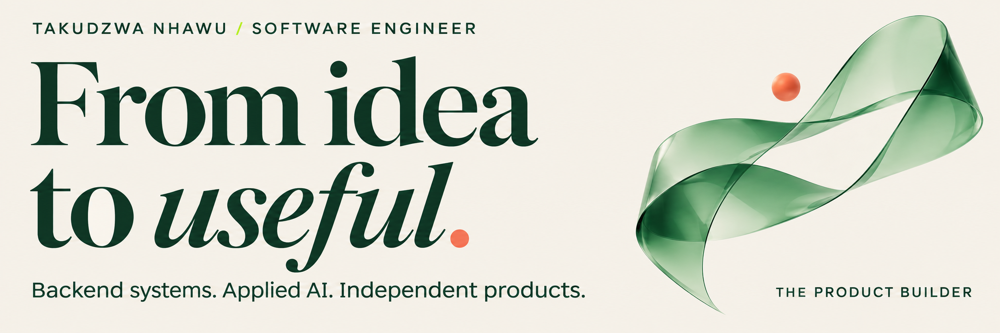
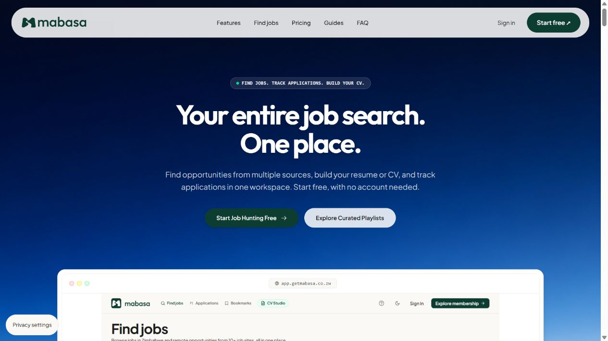
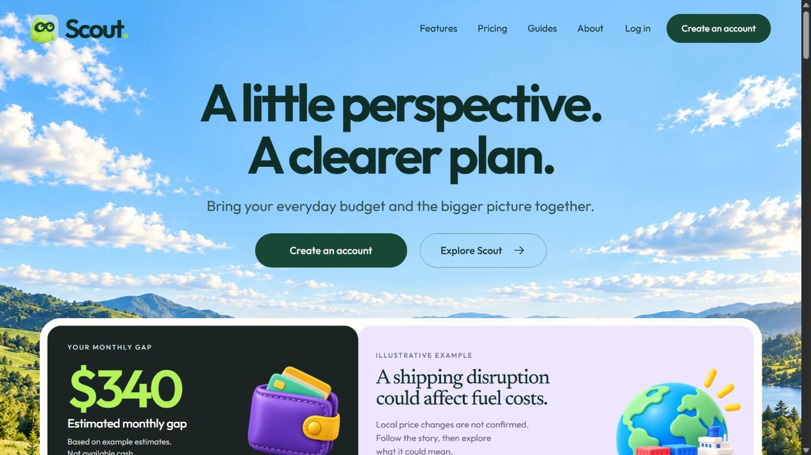
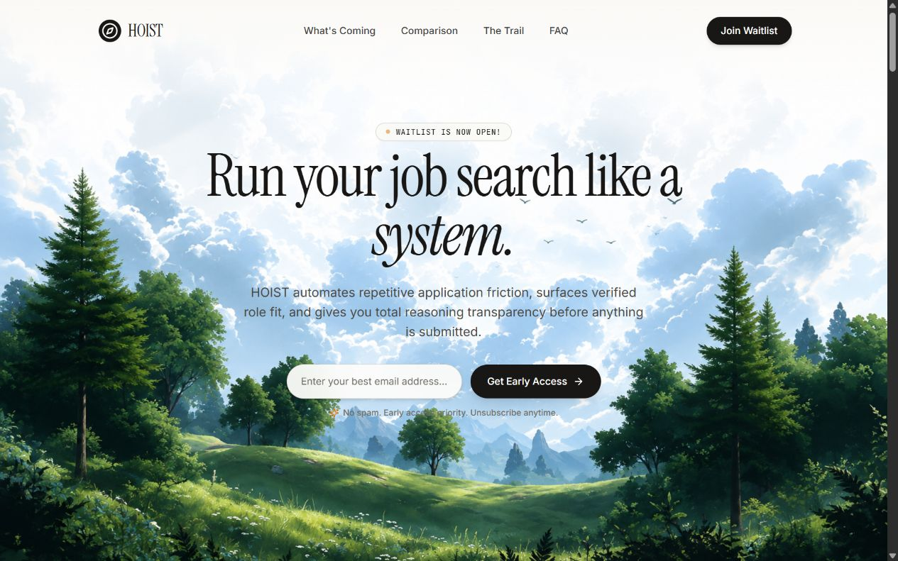

<p align="right"><sub>TAKUDZWA NHAWU &nbsp; / &nbsp; INDEPENDENT PRODUCTS + ENTERPRISE ENGINEERING</sub></p>



# I’m Taku. I build the product and the system behind it.

Software engineer at **Infratech Africa**, working across backend systems, applied AI, and independent products. I built **Mabasa** and I’m developing **Scout** and **Hoist** — tools that bring more clarity to work, money, and the decisions in between.

[Visit my studio ↗](https://takubuilds.site) &nbsp; / &nbsp; [Let’s connect ↗](https://www.linkedin.com/in/nhawu/)

**Take the short route:** [↓ The products](#the-products) · [↓ Engineering record](#engineering-record) · [↓ Open the terminal](#the-terminal) · [↓ Say hello](#say-hello)

<br>

## The products

<sub>01 — INDEPENDENT WORK &nbsp; / &nbsp; DISCOVER → UNDERSTAND → ACT</sub>

### Mabasa &nbsp; / &nbsp; A little clarity for your next move.

**Live platform · Job discovery, applications & CV tools**

[](https://getmabasa.co.zw/)

A promising job in one tab. An application in another. A CV somewhere in your downloads. **Mabasa brings those pieces into one workspace.** Search Zimbabwean and remote opportunities, save a shortlist, track applications, and build a CV.

I built the product across the frontend, backend, and integrations: job aggregation, semantic matching with vector embeddings, personalised recommendations, and payment APIs for optional paid features.

**Engineering focus** &nbsp; Data collection → useful matches → a practical job-search workflow.

[Explore Mabasa ↗](https://getmabasa.co.zw/) &nbsp; · &nbsp; [Browse jobs ↗](https://getmabasa.co.zw/jobs)

<details>
<summary><b>Inside the build</b> — architecture and product choices</summary>

- **Backend:** Python and Django services for aggregation, matching, and product workflows.
- **Frontend:** React interfaces that keep discovery, saved roles, and applications connected.
- **Applied AI:** Vector embeddings and semantic matching to connect experience with opportunities.
- **Integrations:** Pesepay and Payonify payment APIs supporting optional paid features.
- **Product choice:** Keep the everyday job-search tools accessible, with AI guidance as an optional layer.

</details>

<br>

### Scout &nbsp; / &nbsp; World news. Everyday money.

> What could this headline mean for my everyday budget?

[](https://usescout.site/)

**Live preview · Wider product in development**

Scout explores the connection between world events and everyday costs. I designed and built the React experience, including interactive budget scenarios and explanations that distinguish reported facts from possible effects.

**Engineering focus** &nbsp; Source-backed context, explicit uncertainty, and small experiments people can understand.

[Explore the preview ↗](https://usescout.site/) &nbsp; · &nbsp; [Follow the evidence ↗](https://usescout.site/methodology)

<details>
<summary><b>Inside the build</b> — a clearer interface for uncertain information</summary>

- **Interface:** React, Vite, and Tailwind CSS, with responsive layouts and accessible product demonstrations.
- **Interaction:** Budget scenarios let someone explore a change without rewriting their starting numbers.
- **Explanation:** Reported information, possible connections, and unknowns remain distinct.
- **Current scope:** The public website and interactive demonstrations are available; the wider product is still in development. Numbers in the screenshot are examples.

</details>

<br>

### Hoist &nbsp; / &nbsp; Run your job search like a system.

**In development · Public waitlist**

[](https://gethoist.site/)

Finding a role is only the beginning. Hoist is my next step into the work that follows: candidate matching, tailored documents, and application workflows that keep the candidate involved.

I’m developing it around a simple principle: **review the reasoning, review the documents, approve the next step.**

**Engineering focus** &nbsp; AI agents, REST APIs, workflow orchestration, and candidate approval.

[Meet Hoist ↗](https://gethoist.site/) &nbsp; · &nbsp; [See what’s coming ↗](https://gethoist.site/#whats-coming)

<details>
<summary><b>Inside the build</b> — automation with a review step</summary>

- **Direction:** Connect job discovery, candidate matching, tailored CV generation, and application preparation.
- **System:** AI agents and REST API integrations coordinate the workflow.
- **Control:** Candidate review and approval are central to the intended application flow.
- **Current scope:** Hoist is in development. The public site introduces the product and its waitlist; it is separate from Mabasa’s live tools.

</details>

<br>

---

## Engineering record

<sub>02 — BEHIND THE INTERFACE</sub>

### Secure backends. Useful AI. Systems that can be operated.

At **Infratech Africa**, I work on the services, integrations, and delivery infrastructure that support financial and enterprise products.

| Selected work | My contribution |
| :--- | :--- |
| **MEFMI · Sovereign-debt platform** | Architected Java/Spring Boot backend services, PostgreSQL data models, secure REST APIs, access controls, approval workflows, and audit trails. |
| **Database-grounded AI analytics** | Integrated a Python/FastAPI service for natural-language analysis of sovereign-debt indicators. |
| **Enterprise insurance integration** | Built backend workflows connecting conversational claim intake to internal processing systems. |
| **Service delivery & operations** | Deployed Spring Boot, FastAPI, PostgreSQL, and Redis on Linux with Docker and GitHub Actions; configured TLS reverse proxies and monitoring. |
| **Identity & payments** | Implemented Spring Security, OAuth 2.0/JWT authentication, payment integrations, and HMAC-verified webhook notifications. |

[Visit the MEFMI platform ↗](https://mcdebtdata.mefmi.org/) &nbsp; · &nbsp; [Read my engineering background ↗](https://takubuilds.site/cv)

<details>
<summary><b>The path here</b> — experience and education</summary>

**November 2024 – present · Software Engineer · Infratech Africa**  
Backend engineering, applied AI, enterprise integrations, and service delivery.

**July – October 2024 · Software Engineering Fellow · Headstarter**  
Project-based work in system design, scalable architecture, REST APIs, and AI integration.

**March 2023 – March 2024 · IT Intern · Croco Holdings**  
Technical support, networking, system administration, and automation of repetitive support tasks.

**B.Sc. (Hons) Computer Science · University of Zimbabwe · 2024**

</details>

<br>

## The terminal

<sub>03 — FOR THE TECHNICALLY CURIOUS &nbsp; / &nbsp; THE TOOLS COME AFTER THE WORK</sub>

```text
$ whoami
Takudzwa Nhawu / https-taku
Software engineer. Product builder.

$ cat engineering.conf
backend    = Java / Spring Boot
             Python / FastAPI / Django
interfaces = React / JavaScript
             TypeScript / HTML / CSS
data       = PostgreSQL / Redis
             SQL Server / MySQL
ai         = agents / tool-calling
             embeddings / semantic matching
security   = OAuth 2.0 / JWT / HMAC
delivery   = Docker / Linux
             GitHub Actions / Git

$ ls workbench/
APIs/  products/  integrations/  experiments/

$ echo $BUILD_LOOP
understand -> design -> build -> ship -> learn
```

<details>
<summary><b>Expand the workbench</b> — specializations and supporting tools</summary>

| Area | Tools & practices |
| :--- | :--- |
| **Backend engineering** | Java, Spring Boot, Python, FastAPI, Django, REST APIs, Hibernate/JPA, Maven, OpenAPI |
| **Applied AI** | LLM tool-calling, agents, vector embeddings, semantic matching, personalised recommendations |
| **Data & analysis** | PostgreSQL, SQL Server, MySQL, Redis, SQL, pandas, scikit-learn, Chart.js |
| **Interfaces** | React, JavaScript, TypeScript, HTML, CSS, Tailwind CSS |
| **Integration & security** | Payment APIs, OAuth 2.0, JWT, HMAC webhooks, Postman |
| **Delivery & operations** | Docker, Linux, Git, GitHub Actions, AWS, TLS reverse proxies, Prometheus, Grafana |

</details>

<br>

## Say hello

<sub>04 — THE NEXT CONVERSATION</sub>

### Have a useful problem in mind?

I’m interested in conversations about backend engineering, applied AI, and products that make everyday work easier.

**[Connect on LinkedIn ↗](https://www.linkedin.com/in/nhawu/)** &nbsp; / &nbsp; **[Explore my portfolio ↗](https://takubuilds.site)**

[Find me on X](https://x.com/https_takudzwa) &nbsp; · &nbsp; [Instagram](https://www.instagram.com/taku.codess/)

---

<sub>[Public repositories](https://github.com/https-taku?tab=repositories) &nbsp; / &nbsp; [GitHub activity](https://github.com/https-taku?tab=overview) &nbsp; / &nbsp; [Back to the products ↑](#the-products)</sub>

<!-- Asset provenance and update notes: docs/profile-maintenance.md. -->
